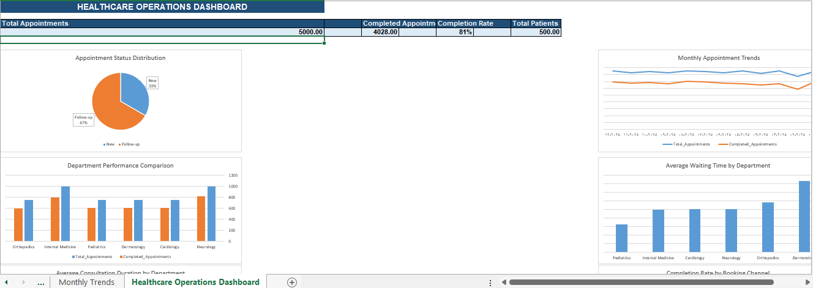

# Healthcare Operations Analysis

## Project Overview

This project analyzes synthetic healthcare operations data for a healthcare facility during 2025.

The objective is to evaluate operational performance, appointment completion, patient behavior, waiting times, consultation duration, and revenue distribution using SQL and Microsoft Excel.

## Dashboard Preview

## Tools & Technologies

- SQLite
- DB Browser for SQLite
- Microsoft Excel
- SQL

## Database Structure

The database contains six relational tables:

| Table | Records |
|---|---:|
| Departments | 6 |
| Doctors | 20 |
| Patients | 500 |
| Appointments | 5,000 |
| Visits | 4,028 |
| Payments | 4,028 |

Total records: 13,582.

## Analysis Areas

1. Department Performance
2. Appointment Status Distribution
3. Waiting Time Analysis
4. Consultation Duration Analysis
5. Monthly Appointment Trends
6. Booking Channel Performance
7. Appointment Type Analysis
8. Payment Method and Revenue Analysis
9. Patient Age Group Analysis
10. Patient Distribution by City
11. Doctor Performance Analysis
12. Data Quality Checks

## Key Findings

- Overall appointment completion rate: 80.56%.
- Neurology recorded the highest number of completed appointments.
- Online booking had the highest completion rate among booking channels.
- Dermatology had the highest average waiting time.
- Orthopedics had the longest average consultation duration.
- Cash payments generated the highest recorded revenue.
- Patient distribution was equal across the four cities.

## Data Quality

Eight data quality checks were performed. All checks passed, including:

- Referential integrity
- Duplicate visit and payment records
- Appointment and visit consistency
- Payment record validity
- Visit timing validity

## Analytical Limitations

The following characteristics should be considered when interpreting the results:

- The dataset is synthetic and does not represent actual healthcare operations.
- Patient records are evenly distributed across four cities.
- No patients under 18 years of age are included in the dataset.
- New appointment records show the same count and completion rate as online bookings, indicating a correlation in the synthetic data generation process.
- Differences in doctor performance metrics should not be interpreted as definitive measures of clinical quality.

These limitations are documented to ensure transparent and responsible interpretation of the analysis.

## Important Note

This project uses entirely synthetic data created for educational, analytical, and portfolio demonstration purposes. It does not contain real patient information or represent the actual performance of a healthcare facility.

## Project Files

- `Database/` — SQLite database
- `SQL/` — SQL queries and analysis
- `Reports/` — Excel analysis and dashboard
